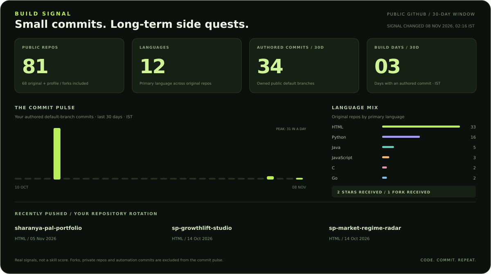

<a href="https://github.com/sharanyapal?tab=repositories">
  
</a>

<p align="center">
  <a href="#build-signal">Build signal</a> &nbsp; / &nbsp;
  <a href="#pick-a-genre">Pick a genre</a> &nbsp; / &nbsp;
  <a href="#behind-the-keyboard">Behind the keyboard</a> &nbsp; / &nbsp;
  <a href="https://www.linkedin.com/in/sharanya-pal-a9a637187/">Say hello ↗</a>
</p>

## Build signal

<!-- PROFILE:LIVE:START -->


**81 public repos** · **12 primary languages** · **34 authored commits / 30 days** · **3 build days / 30 days** · **2 stars received** · **1 forks received**

### Recently in the rotation

| Repository | Primary language | Last push (IST) |
| :-- | :-- | :-- |
| [sharanya-pal-portfolio](https://github.com/sharanyapal/sharanya-pal-portfolio) | HTML | 05 Nov 2026 |
| [sp-growthlift-studio](https://github.com/sharanyapal/sp-growthlift-studio) | HTML | 14 Oct 2026 |
| [sp-market-regime-radar](https://github.com/sharanyapal/sp-market-regime-radar) | HTML | 14 Oct 2026 |
| [sp-creditsense-underwriting](https://github.com/sharanyapal/sp-creditsense-underwriting) | HTML | 14 Oct 2026 |
| [sp-banktrace-fraud-network](https://github.com/sharanyapal/sp-banktrace-fraud-network) | HTML | 14 Oct 2026 |

### Fresh from the keyboard

- **Revise README with updated profile and projects** — [sharanyapal@8fab447](https://github.com/sharanyapal/sharanyapal/commit/8fab44755a2b03e2892c3e48571fdca93363c16d) · 08 Nov
- **docs: link career project portfolio from main README** — [sharanya-pal-portfolio@b82ffe5](https://github.com/sharanyapal/sharanya-pal-portfolio/commit/b82ffe5cb092170f1a803a2ec353f6947d14655b) · 05 Nov
- **docs: add evidence-based security, data science and polyglot project index** — [sharanya-pal-portfolio@6e739d0](https://github.com/sharanyapal/sharanya-pal-portfolio/commit/6e739d02fdb50dab8cbb8f6fa672073395ad7b1b) · 05 Nov

<details>
<summary>How the signal works</summary>

The dashboard checks my public repositories every 30 minutes and refreshes after pushes to this profile repository. GitHub scheduling and image caching can add a delay.

Commit counts cover my authored commits on the default branches of owned, non-fork public repositories over 30 calendar days in India time. The pulse is not GitHub's contribution graph or an all-time total. Language counts reflect primary repository languages, not proficiency. Private repository details are never included. Generated bot commits do not count toward the pulse.

The dashboard only commits when its data or daily window changes. The timestamp shows when the displayed signal changed, not when a visitor last opened the page.

</details>
<!-- PROFILE:LIVE:END -->

## Pick a genre

Some people collect playlists. I collect rabbit holes.

| Collection | Start here | The rabbit hole |
| :-- | :-- | :-- |
| 🛡️ **Security & IAM** | [Identity Policy Auditor](https://github.com/sharanyapal/sp-iam-policy-engine) | Who can do what — and who really should not? |
| 🧠 **AI & ML** | [Neural Playground](https://github.com/sharanyapal/sp-advanced-neural-playground) · [Grounded RAG](https://github.com/sharanyapal/sp-advanced-grounded-rag) | Teaching networks; making retrieval show its sources. |
| 📈 **Fintech** | [BankTrace](https://github.com/sharanyapal/sp-banktrace-fraud-network) · [Market Regime Radar](https://github.com/sharanyapal/sp-market-regime-radar) | Following the patterns in synthetic transfers and market series. |
| ⚙️ **Systems** | [Rate Governor](https://github.com/sharanyapal/sp-go-rate-governor) · [Event Horizon](https://github.com/sharanyapal/sp-event-horizon) | Taming traffic. Finding the signal in the logs. |
| 🎮 **The Arcade** | [Knightfall Chess](https://github.com/sharanyapal/sp-advanced-chess-engine) · [PAC//MAZE](https://github.com/sharanyapal/sp-advanced-pac-maze) | Just one more game. For algorithm research, obviously. |
| 🎨 **Creative Code** | [Pixel Foundry](https://github.com/sharanyapal/sp-pixel-foundry) · [Graph Forge](https://github.com/sharanyapal/sp-graph-forge) | Pixels, paths, and experiments you can poke. |

**[Browse the full collection →](https://github.com/sharanyapal/sharanya-pal-portfolio)**

## Behind the keyboard

I'm **Sharanya**, a Bengaluru-based engineer. By day: **IAM support at TCS**. After hours: side quests in software, security, and data science while pursuing the **IIT Madras BS in Data Science and Applications**.

```javascript
const sharanya = {
  defaultMode: "curious",
  favouriteLoop: ["build", "break", "understand", "improve"],
  sideQuests: ["painting", "synthesizer", "photography", "gaming"],
  currentlyDebugging: "the balance between one more feature and sleep"
};
```

<p align="center">
  <a href="mailto:sharanyapal856@gmail.com">Email</a> &nbsp; · &nbsp;
  <a href="https://www.linkedin.com/in/sharanya-pal-a9a637187/">LinkedIn</a> &nbsp; · &nbsp;
  <a href="https://github.com/sharanyapal?tab=repositories">Explore my repos</a>
</p>

<p align="center"><sub>Serious about the craft. Playful about the process.</sub></p>
